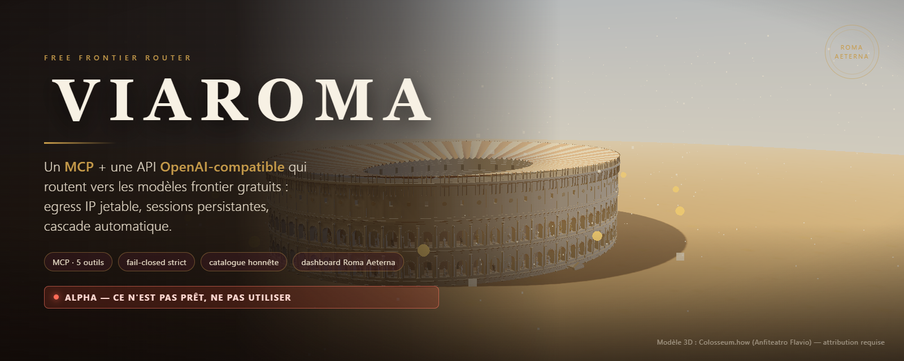
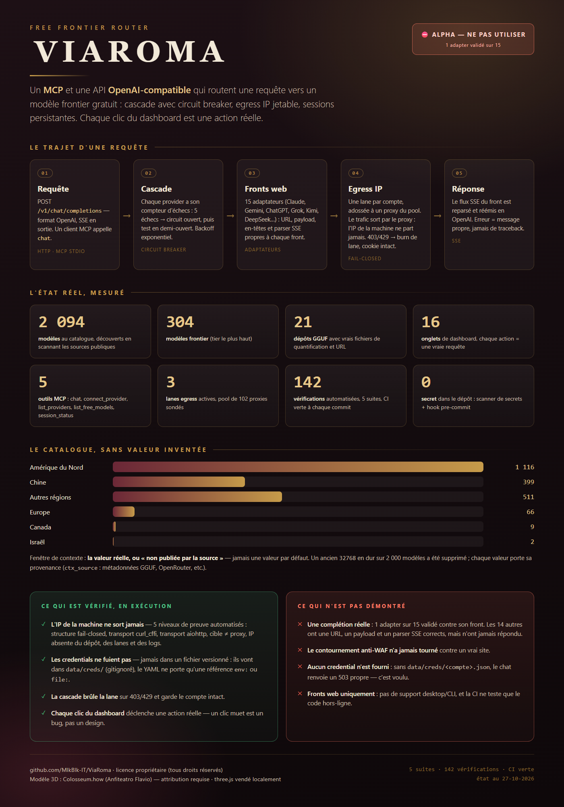

<div align="center">



<br/>


</div>

> # ⚠️⚠️⚠️ CE N'EST PAS PRÊT. NE L'UTILISEZ PAS. ⚠️⚠️⚠️
>
> # ⛔ NE PAS UTILISER ⛔
>
> **Ce projet n'est pas terminé et n'est pas fiable en production.**
> Il est publié ici **pour que le travail soit visible et critiquable**, pas pour être utilisé.
>
> Ce qui n'est **pas** démontré :
>
> - ❌ **Aucune complétion réelle.** Un seul adapter (`claude_web`) a été validé contre son
>   front. Les 14 autres ont une `chat_path` / `sse_kind` / un payload corrects, mais
>   **n'ont jamais répondu**. N'en déduisez pas qu'ils marchent.
> - ❌ **Le contournement anti-WAF n'a jamais tourné contre un vrai site.** Camoufox n'a
>   jamais été exercé sur un site réel.
> - ❌ **Les credentials ne sont pas fournis.** Sans `data/creds/<compte>.json` (que vous
>   devez créer vous-même), `chat` renvoie un 503 propre. C'est voulu : le secret ne
>   touche jamais ce dépôt.
> - ❌ **Le `PROVIDER_META` ne couvre que les fronts web.** Aucun support desktop/CLI.
> - ❌ **La CI ne prouve pas le comportement réseau**, seulement le code hors-ligne.
>
> **Ce qui est solide et vérifié** : le fail-closed (aucun provider n'est appelé sans
> proxy de sortie — 5 niveaux de preuve automatisés), la cascade et le circuit breaker,
> le dashboard (chaque clic = une action réelle), le catalogue (métriques réelles
> uniquement, provenance tracée), le garde-fou anti-fuite de secrets.
>
> Vous forkez, vous lisez, vous critiquez — **mais vous ne l'utilisez pas sur de vraies
> données, et vous ne branchez pas de vrai compte dessus** tant que ces points ne sont
> pas levés. L'état détaillé, module par module, est dans [`PROGRESS.md`](PROGRESS.md).

> ## 🚧 ALPHA — pas de release — développement actif 🚧
>
> Le HTTP et le MCP répondent, la cascade est câblée, le pool egress tourne, le dashboard
> s'affiche. **Ce qui n'est pas démontré : une complétion réelle.** Voir
> [`PROGRESS.md`](PROGRESS.md) pour l'état honnête, module par module.

> ## 🔒 Licence propriétaire — tous droits réservés
>
> Ce dépôt n'est **pas** sous licence libre. Usage personnel sur votre propre machine,
> redistribution / fork public / usage commercial interdits sans accord écrit.
> Voir [`LICENSE`](LICENSE). Le modèle de sécurité et la procédure de signalement
> de failles sont dans [`SECURITY.md`](SECURITY.md).

---

## 🏛️ What is ViaRoma?

<div align="center">

</div>

**ViaRoma** — *via Romana*, "all roads lead to Rome". Un point d'entrée unique qui donne
accès à des **modèles frontier gratuits** : une API OpenAI-compatible et un **serveur MCP**,
branchables sur n'importe quel agent.

L'architecture repose sur trois idées inhabituelles pour un proxy :

| Idea | Implementation |
|---|---|
| **L'IP de sortie est jetable** | `EgressLanePool` tient un pool de SOCKS5/HTTP/Tor, les sonde, met en quarantaine les morts. |
| **Une session appartient à un compte, pas à une IP** | Chaque `account_id` est lié 1:1 à une **lane** persistante (proxy + profil TLS). Lane brûlée → lane remplacée, le cookie jar reste. |
| **L'échec est un signal de routage** | Un `CircuitBreaker` par provider classe `429` / `403` / challenge, ouvre le circuit, et **brûle la lane** avant de basculer. |

```text
agent (Hermes, Claude Code, …)
   │
   ├── MCP stdio ──▶ src/mcp_server.py ──┐
   │                                    │
   └── HTTP ───────▶ src/main.py ────────┤
                                        ▼
                     CascadeManager ──▶ CircuitBreaker (par provider)
                                        │   ├── 429 rate limit ──▶ burn lane
                                        │   ├── 403 permission ──▶ burn lane
                                        │   └── challenge ───────▶ burn lane
                                        ▼
                     ProxyLayer ──▶ ProviderAdapter (16 providers)
                                        │
                                        ▼
                     TLSSpoofer (curl_cffi JA3/JA4) ──▶ SSE ──▶ ChatChunk
```

<div align="center">


<br/>


</div>

---

## 📐 Modules — `find src -name '*.py' -o -name '*.js'`

**18 modules · 5 829 lignes · Python 3.12**

| Module | Lignes | Rôle |
|---|---:|---|
| [`src/main.py`](src/main.py) | 140 | App FastAPI, hooks startup/shutdown, `/v1/chat/completions` (stream + non-stream), `/v1/egress/stats`, dashboard monté. |
| [`src/mcp_server.py`](src/mcp_server.py) | 275 | **Serveur MCP** (stdio / sse / streamable-http) : 5 outils, même noyau que l'API. |
| [`src/core/cascade.py`](src/core/cascade.py) | 264 | `CircuitBreaker` (CLOSED/OPEN/HALF_OPEN, métriques par provider, backoff exponentiel) + `CascadeManager`. Charge `config/cascade.yaml`. |
| [`src/proxy/egress_lanes.py`](src/proxy/egress_lanes.py) | 661 | `EgressLanePool` — IP egress jetables, lanes 1:1 par `account_id`, health loop, quarantaine, `burn_lane()`, `add_proxy()`, `rebind()`. |
| [`src/proxy/identity.py`](src/proxy/identity.py) | 312 | `IdentityManager` — une **machine complète par compte** : IP + empreinte TLS + empreinte navigateur (UA, locale, fuseau, écran, WebGL, canvas). Stable et distincte. |
| [`src/proxy/anti_waf_harvester.py`](src/proxy/anti_waf_harvester.py) | 446 | Pile anti-WAF hybride : Camoufox headless pour passer Turnstile/Cloudflare, puis curl_cffi avec spoof JA3/JA4 complet ; repli aiohttp. |
| [`src/proxy/proxy_engine.py`](src/proxy/proxy_engine.py) | 352 | `ProviderAdapter` × 16 (15 web + passthrough OpenAI), `TLSSpoofer`, `PROVIDER_META`, `ADAPTER_REGISTRY`. |
| [`src/proxy/sse_converter.py`](src/proxy/sse_converter.py) | 271 | Normalisation SSE native → `ChatChunk` pour 3 dialectes : OpenAI, Claude, Gemini. |
| [`src/sessions/session_manager.py`](src/sessions/session_manager.py) | 254 | Rotation multi-comptes, isolation des cookie jars, binding de lane par compte, cooldown / rate-limit / challenge, persistance JSON. |
| [`src/hunter/hunter.py`](src/hunter/hunter.py) | 342 | `FreeHunter` — découverte de modèles frontier gratuits (OpenRouter, HuggingFace, apps desktop), filtre de tier, catalogue persistant. |
| [`src/dashboard/routes.py`](src/dashboard/routes.py) | 885 | 43 endpoints : stats, actions, édition de config, credentials, egress, anti-WAF. |
| [`src/dashboard/config_io.py`](src/dashboard/config_io.py) | 118 | Lecture/écriture des 5 fichiers de config, squelettes par défaut **sans donnée sensible**, backups. |
| [`src/config_loader.py`](src/config_loader.py) | 61 | Charge `accounts.yaml` et résout `credentials_ref` (`env:` \| `file:`). |
| [`src/providers/providers.py`](src/providers/providers.py) | 80 | `BaseProvider` + registre des web chats, scoring de santé, délégation aux vrais adaptateurs. |
| [`src/schemas.py`](src/schemas.py) | 24 | Modèles Pydantic : `ChatMessage`, `ChatCompletionRequest`, `ChatChunk`. |
| [`src/dashboard/static/app.js`](src/dashboard/static/app.js) | 697 | Pilotage : 10 onglets, actions, refresh 2 s, charts. |
| [`src/dashboard/static/charts.js`](src/dashboard/static/charts.js) | 254 | Canvas 2D sans lib, thème **Roma Aeterna** : couronne de laurier, colonnes romaines, aqueduc. |
| [`src/dashboard/static/colosseum.js`](src/dashboard/static/colosseum.js) | 194 | Colisée 3D en canvas, sans dépendance. |
| [`src/dashboard/static/style.css`](src/dashboard/static/style.css) | — | Thème « Roma Aeterna » : or, ivoire, verre, colonnes. |
| [`src/dashboard/static/index.html`](src/dashboard/static/index.html) | — | Squelette du dashboard, cache-busting `?v=`. |

---

## 🔌 Le serveur MCP

C'est la porte d'entrée pour les agents. Cinq outils, pas un de plus :

| Outil | Ce qu'il fait |
|---|---|
| `chat` | Envoie un message, la cascade route en interne, retourne le texte. L'agent ne choisit jamais le provider. |
| `connect_provider` | Connecte un compte **une fois** (harvest de session via Camoufox). Ne renvoie jamais la valeur des credentials. |
| `list_providers` | La matrice des providers + l'état de connexion de chaque session. |
| `list_free_models` | Le catalogue des modèles gratuits, filtré par tier. |
| `session_status` | Santé live : providers, sessions, lanes, IPs, burns, cooldowns. |

### Brancher un agent

```jsonc
// claude_desktop_config.json / mcp.json — transport stdio
{
  "mcpServers": {
    "via-roma": {
      "command": "via-roma-mcp"
    }
  }
}
```

```bash
# ou en HTTP, pour un agent déjà habitué au streamable-http
via-roma-mcp --transport streamable-http --port 8001
```

Les logs du serveur partent sur **stderr** : stdout est réservé au protocole.

---

## 🛣️ Egress Lanes — le cœur du design

L'IP de sortie est une **ressource consommable**, pas un réglage. C'est cette décision qui
rend la rotation de comptes et la survie aux rate-limits par IP traitables.

```text
                    EgressLanePool
        ┌───────────────────────────────────────────┐
        │  pool: SOCKS5 · HTTP · Tor · listes       │
        │         probe_endpoint() → santé           │
        └───────────────────┬───────────────────────┘
                            │ bind(account_id)
                            ▼
        account:perso   ──▶ [ lane-A · proxy · profil TLS ]
        account:ecole   ──▶ [ lane-B · proxy · profil TLS ]
                            │
                            │ burn_lane(account_id, "429 rate_limit")
                            ▼
        lane remplacée depuis le pool — cookie jar intact
```

* **Lane persistante** — un compte garde la même identité de sortie d'une requête à l'autre.
* **`burn_lane()`** — sur `403` / `429` / challenge, le circuit breaker rappelle
  `SessionManager.burn_lane()`, qui remplace la lane et garde les cookies.
* **Health loop** — toutes les 120 s, chaque lane est sondée (IP publique, latence, pays/ASN)
  puis mise en quarantaine si morte. État persisté dans `data/egress_lanes.json`.
* **Les credentials restent hors du code** — les comptes résolvent leurs secrets via
  `credentials_ref: env:NAME | file:path`. Aucune clé n'est en dur, rien n'est versionné.

---

## 🧬 Identités — une machine par compte

Les services free-tier limitent souvent une personne à **1 ou 2 comptes**. ViaRoma répond
en donnant à chaque compte une **identité de machine complète** :

| Couche | Ce qui varie par compte |
|---|---|
| **Réseau** | L'IP de sortie (lane), unique et disposable. |
| **TLS** | Le profil JA3/JA4 (`chrome120`, `chrome119`, `firefox133`, `safari17`). |
| **Navigateur** | User-Agent, `sec-ch-ua`, plateforme, locale, fuseau horaire, résolution d'écran, viewport, `deviceMemory`, `hardwareConcurrency`, WebGL vendor/renderer, graine de bruit canvas. |

Deux invariants, tenus par `IdentityManager` :

* **Stable** — un compte garde la même identité d'un bout à l'autre. Changer d'empreinte en
  cours de session, c'est se faire bannir.
* **Distincte** — deux comptes ne partagent jamais la même empreinte. Le service voit une
  personne par identité, pas dix comptes.

L'identité est **dérivée d'un seed** = `hash(account_id + salt d'install + rotation)`. Donc
reproductible sans stocker 30 champs, unique par compte, et rotable : un nouveau seed donne
une nouvelle identité cohérente.

**Le couplage est la clé** : `burn_lane()` fait tourner l'IP **et** l'empreinte **ensemble**.
Une nouvelle IP avec la même empreinte, c'est un compte qui « saute de machine ».

L'onglet **🧬 Identities** du dashboard affiche l'état par compte et la rotation.

---

## ⚡ Quick start

```bash
# Python 3.12 est requis — curl_cffi n'a pas de wheel _cffi_backend en 3.14+
py -3.12 -m venv .venv
.venv/Scripts/pip install -r requirements.txt

# API HTTP + dashboard, depuis la racine du dépôt
.venv/Scripts/python -m src.main

# serveur MCP (stdio) pour un agent
.venv/Scripts/python -m src.mcp_server
```

Les modèles 3D du Colisée (32 Mo) ne sont pas dans le dépôt. Une seule fois :

```bash
.venv/Scripts/python scripts/fetch_3d_assets.py
```

Sans eux, le dashboard bascule sur un Colisée procédural — il fonctionne quand même.

L'API écoute sur **port 8000** (surchargeable : `VIAROMA_PORT`) :

```bash
curl http://127.0.0.1:8000/v1/chat/completions \
  -H 'Content-Type: application/json' \
  -d '{"model":"auto","messages":[{"role":"user","content":"ping"}],"stream":true}'

curl http://127.0.0.1:8000/v1/egress/stats
```

Le dashboard est sur **http://127.0.0.1:8000/dashboard/** — 16 onglets, thème Roma Aeterna.

Tout client OpenAI-compatible marche : pointe son `base_url` sur `http://127.0.0.1:8000/v1`.

### 📦 Installation en paquet

Le dépôt est empaqueté pour npm et PyPI. Les deux chemins sont **préparés et
testés en CI** ; la publication elle-même demande un compte/token.

```bash
# npm : le paquet installe les lanceurs (ils trouveront Python 3.12 seul)
npm install -g via-roma
via-roma-mcp      # serveur MCP (stdio)
via-roma          # API HTTP + dashboard

# PyPI
pip install via-roma
via-roma-mcp
via-roma
```

`config/` (comptes, cascade, pool egress) est livré avec le paquet ; `data/`
(identités, lanes, catalogue, sessions) est créé au premier lancement.

Pour stocker's l'état ailleurs que dans le dossier du paquet :

```bash
export VIAROMA_HOME=/chemin/vers/etat      # config/ + data/ y seront
```

Si Python 3.12 n'est pas trouvé, le lanceur s'arrête avec le message exact à
suivre (`VIAROMA_PYTHON` ou `pip install -r requirements.txt`) — il ne
devine pas et ne fait pas semblant.

### Requirements

| Package | Rôle |
|---|---|
| `fastapi`, `uvicorn` | Surface HTTP et serveur ASGI |
| `mcp` | Serveur MCP (stdio / sse / streamable-http) |
| `pydantic` | Schémas requête/réponse |
| `curl_cffi` | Impersonation TLS (JA3/JA4) — **Python 3.12 uniquement** |
| `aiohttp` | Transport de repli quand curl_cffi est indisponible |
| `camoufox` | Navigateur headless pour passer les challenges WAF |
| `redis` | État partagé optionnel |

---

---

## 🛡️ Sécurité — l'IP réelle ne sort jamais, les credentials ne fuient pas

C'est une **garantie structurelle**, pas une option. Elle est appliquée dans le noyau et
vérifiée par `tests/test_security_context.py`.

| Garantie | Comment elle est tenue | Testé |
|---|---|---|
| **L'IP de la machine n'est jamais transmise** | Aucun provider n'est exécuté sans proxy de sortie : `build_providers()` **écarte** le compte (`fail-closed`) au lieu de le lancer en direct. Le proxy vient de la **lane du compte**, jamais d'un réglage global. | ✅ |
| **L'IP réelle n'est jamais affichée** | L'API ne renvoie que l'IP de sortie (`lane.proxy.public_ip`). L'IP locale n'est ni lue, ni loguée, ni exposée par `/api/dashboard/security/summary`. | ✅ |
| **Les credentials ne quittent jamais la machine** | Résolution à la volée (`env:VAR` / `file:chemin`) au moment de la requête. Aucune valeur n'est journalisée, retournée par l'API, ni stockée dans le dépôt. | ✅ |
| **Aucun cookie n'est renvoyé** | Les endpoints de session renvoient un **nombre** de cookies, jamais leurs valeurs. | ✅ |
| **Les jetons ne voyagent pas en cookie** | Le champ `cookie` est une *chaîne* de cookies : elle est cassée en jar. Les jetons (`access_token`, `token`, `api_key`, `auth_token`) sortent en header `Authorization` ; les méta (`org_id`, `device_id`) dans l'URL ou un header dédié. | ✅ |
| **Le dashboard n'écoute que sur la boucle locale** | `VIAROMA_HOST` vaut `127.0.0.1` par défaut. Le dashboard expose l'état de routage : il n'a rien à faire sur le LAN. | — |
| **Le dépôt ne contient aucun secret** | `data/` est gitignoré ; les comptes ne pointent que vers des références. | ✅ |

Le dashboard expose l'état de ces garanties en direct (onglet **Overview → Garanties actives**),
avec la liste des comptes écartés et la raison.

### Le routage part d'un contexte unique par compte

C'est le point qui rend les garanties tenables. Une requête ne se construit plus à partir de
réglages dispersés, mais d'un **contexte** qui porte l'identité complète du compte :

```text
contexte(account_id)
  ├── proxy       ← lane egress du compte      (obligatoire, sinon fail-closed)
  ├── tls_profile ← profil JA3/JA4 de l'identité du compte
  ├── user_agent  ← UA récolté par le navigateur (sinon celui de l'identité)
  ├── locale      ← locale de l'identité (Accept-Language suit)
  └── creds       ← jar de cookies récolté + credentials résolus
```

Envoyer une requête depuis une autre IP que celle du navigateur, ou avec un autre profil TLS
que celui de l'identité, c'est exactement ce qui fait bannir un compte. Ici, les cinq éléments
viennent de la **même** source.

---

## 🎨 Le dashboard « Roma Aeterna »

* **Le Colisée en WebGL (vrai 3D)** — Three.js + un **modèle GLB réel** du Colisée
  (reconstruction de l'Anfiteatro Flavio, 80 d.C. et état actuel) : ombres portées,
  bloom, torches qui vacillent, poussière en suspension, caméra panoramique lente,
  glissement à la souris et zoom à la molette. Repli automatique sur un Colisée
  procédural si le GLB ou WebGL sont indisponibles.
  Les modèles sont trop volumineux pour le dépôt : `python scripts/fetch_3d_assets.py`.
  three.js est **vendu local** (`vendor/three/`) — aucun CDN à l'exécution.
  Attribution : [Colosseum.how](https://www.colosseum.how/it/modello-3d) — voir `CREDITS.md`.
* **Side panel complet groupé** — Pilotage / Observabilité / Architecture / Playground /
  Configuration / Opérations. Chaque entrée ouvre un onglet réel, jamais un log vide.
* **Overview en tuiles** — Centre de commandement (chaîne de routage réelle, cliquable),
  Trafic & catalogue, Requêtes live (journal réel) et Garde-fous (fail-closed).
* **Graphe d'architecture live** — le graphe d'orchestration de ViaRoma en SVG, alimenté
  par les données du serveur : superviseur, adaptateurs, egress, mémoire partagée,
  registre d'outils, synthèse. Chaque nœud ouvre sa fiche et ses actions.
* **Onglet Live** — sorties et annonces **scrapées en direct** (Hugging Face papiers du
  jour et modèles créés récemment, r/LocalLLaMA, Hacker News, blogs OpenAI et Google AI),
  plus les dépôts GGUF avec leurs **vrais fichiers de quantification** (nom, taille, URL).
* **Intro « rue romaine → Colisée »** — au démarrage, la caméra descend une rue de paving
  stones entre des colonnes et des arcs, torches allumées, et débouche devant le Colisée.
  Sautable (clic / Échap), et désactivée si `prefers-reduced-motion` est actif.
* **Animation d'IP spoofing** — l'identité entre dans un arc romain, s'y scramble, et en ressort
  transformée. L'IP réelle y est **masquée par construction** : elle n'est jamais écrite.
* **Animations d'interface** — entrée du Colisée, apparition des cartes, compteurs qui bondissent,
  reflet sur les boutons, halo pulsé sur les pastilles d'état.

### 🔎 Le catalogue : des métriques réelles, pas des valeurs inventées

Le Free Hunter scrape les API publiques **au runtime**. Le point important :
**aucune fenêtre de contexte n'est devinée**.

* Quand la source publie la valeur, elle est reprise telle quelle et la source est
  tracée (`ctx_source`) : Hugging Face (métadonnées GGUF), OpenRouter, NVIDIA.
  Les valeurs sont réellement différentes (262 144, 1 000 000, 128 000, 40 960…).
* Quand la source ne la publie pas, le catalogue affiche **« non publiée par la source »**
  — il n'y a plus de `32768` appliqué en dur à tout le catalogue.
* **Origine du laboratoire** : chaque modèle est taggé (Chine, Europe, États-Unis,
  Canada, Israël, Corée, E.A.U.) et filtrable — les labos chinois et européens ne
  sont plus relégués.
* **Modes de téléchargement GGUF** : pour les dépôts GGUF, la liste réelle des
  fichiers de quantification (`Q4_K_M`, `Q5_K_M`, `Q8_0`, `F16`…) avec leur **taille
  en octets** et l'URL de téléchargement.
* **Applications locales détectées** : LM Studio, Cherry Studio, Jan, Unsloth, Ollama,
  GPT4All, KoboldCpp, Open WebUI… cherchées dans les vrais dossiers d'installation
  Windows (`%LOCALAPPDATA%\Programs`), pas seulement dans le `PATH`.

---

## 🎯 Scope & ethics

ViaRoma est un **projet de recherche personnel** sur l'accès free-tier et l'identité de sortie
— comprendre comment un client peut garder une identité de session cohérente quand le chemin
réseau en dessous change (et l'inverse).

* Ce n'est **ni** un harvester de credentials, **ni** un service de scraping, **ni** un produit
  de contournement.
* Aucun cookie, token ou clé n'est livré. Les secrets restent chez l'utilisateur.
* Le code anti-WAF existe pour comprendre les mécaniques de challenge et garder une session
  vivante.
* Chaque usage reste la responsabilité de l'opérateur, aux conditions des services concernés.

---

## 📜 Licence

**Propriétaire — tous droits réservés.** © 2026 MlkBlk-IT.

Ce dépôt n'est **pas** sous licence libre. Ce qui est permis : lire, exécuter et
faire tourner ViaRoma sur votre propre machine, pour votre usage personnel.

Ce qui est interdit sans accord écrit préalable : redistribuer le code (fork,
copie, archive, paquet npm / PyPI), publier une version dérivée, vendre ou
sous-licencier le logiciel, ou masquer les mentions de copyright.

Le texte fait foi : [`LICENSE`](LICENSE). L'auteur se réserve le droit de retirer
le code, notamment en cas de fuite de credentials ou d'usage détourné.

> **Pourquoi pas une licence libre ?** MIT ou Apache donneraient à n'importe qui le
> droit de redistribuer, forker et commercialiser le projet — c'est-à-dire de
> reprendre la conception telle quelle. La valeur de ViaRoma est dans le
> fonctionnement du routage et des identités : elle se protège en gardant le code
> fermé. Si vous voulez utiliser ViaRoma commercialement ou le redistribuer,
> demandez.

Le modèle de sécurité, les limites assumées et la procédure de signalement de
failles sont dans [`SECURITY.md`](SECURITY.md).

---

## 📊 Status

Ce dépôt est **alpha, auto-documenté**. [`PROGRESS.md`](PROGRESS.md) liste ce qui est vérifié,
ce qui est.stubé, et la prochaine étape. Alpha means alpha : ce qui n'est pas fini est marqué
comme tel, jamais caché.

<div align="center">


<sub>
`mcp` · `openai-compatible` · `free-tier` · `frontier-models` · `fallback-cascade` ·
`circuit-breaker` · `egress-ip` · `proxy-pool` · `socks5` · `tor` · `tls-fingerprint` ·
`ja3` · `curl-cffi` · `camoufox` · `anti-waf` · `sse` · `fastapi` · `python312` · `cpu-only` ·
`self-hosted` · `session-rotation` · `cookie-jar` · `multi-account`
</sub>

</div>
